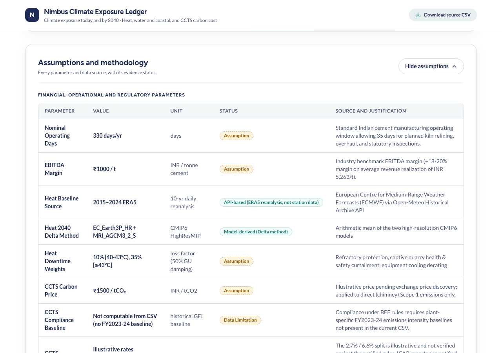

# Nimbus Climate Exposure Ledger

A static executive dashboard showing what climate events cost Nimbus Cement Ltd, today and by 2040, across its 9 plants. Built for the Head of Sustainability to present to a board, statutory auditors and lenders.


## What it shows

Exposure is always split into three parts and never summed into one unlabelled number.

| Component | Label | Source |
| :--- | :--- | :--- |
| Extreme heat downtime | `API-based` | ERA5 reanalysis 2015–2024, plus a CMIP6 delta method for 2040 |
| Water and coastal curtailment | `Assumption` | Site-level judgement, labelled "judgement, not sourced" |
| CCTS carbon liability | `Assumption, scenario` | Emissions × % cut × ₹1,500/tCO₂ |

Fleet facts: 9 plants, ₹15,450 Cr gross asset base, 23.00 MTPA capacity, 18.35 Mt output, 10,932 kt direct Scope 1 CO₂.

### Things to know before presenting

- **CCTS today is not computable.** The CSV has no FY2023-24 baseline. The Today bar shows a hatched upper bound at illustrative rates (≤ ₹44.74 Cr/yr) that is not part of the ₹46.90 Cr/yr total.
- **The increase is a floor.** Today's CCTS is only an upper bound, so the banner says "at least ₹152.06 Cr/yr", with CCTS at least 78.4%. At illustrative rates the CCTS increase is ₹0.00 because emissions are held flat.
- **The CCTS rates are illustrative, not verified.** The 2.7% integrated / 6.6% grinding split is not confirmed against the notified rules. ICAP reports the notified cement range as 4.7–7.6% for FY2025-26 to FY2026-27, set per plant. No gazetted target runs to 2040, so both 2040 cases (illustrative, and stretch 10%) are scenarios.
- **The clinker toggle changes Scope 1 and intensity only.** Every ₹ value, including CCTS, uses direct chimney emissions in both views. Fleet Scope 1 is 10,932 kt either way, but CCTS totals would differ at these rates (₹44.74 vs ₹56.84 Cr/yr), so adjusted CCTS is not shown.
- **The ledger is sortable** by any column (default: 2040 total, descending) and the plant column stays pinned when scrolling.
- **Flood API data is context only.** River discharge does not feed any ₹ figure.

| Ledger with clinker toggle | Assumptions section | Plant drawer |
| :---: | :---: | :---: |
|  |  |  |

## For the developer: what to do next

This repo is a working prototype with the data baked in. It was built to answer one question for one company. The full spec is in [DEVELOPER_TICKET.md](DEVELOPER_TICKET.md). In plain terms, do these five things in order:

1. **Move the maths out of the UI.** The formulas live inside `src/App.tsx` and the Python scripts. Put them in one small function that takes plant data and assumptions and returns the ₹ figures. Write tests that must give the numbers below.
2. **Make the data refresh itself.** Today the weather numbers come from cached files (`open_meteo_*_cache.json`). Write a scheduled job that fetches Open-Meteo, saves a dated snapshot, and rebuilds the JSON. The app keeps reading static files, not live APIs, so numbers stay reproducible for an auditor.
3. **Let Nimbus upload its own plants.** Replace the bundled CSV with an upload that checks the file (scope 1 must be a number, shipped clinker cannot exceed produced clinker, and so on) and says what is wrong.
4. **Make the assumptions editable.** Margin, carbon price, CCTS rates and water days should sit in a versioned config where each change is logged, not in code.
5. **Replace the guessed water days.** Use WRI Aqueduct scores. Someone from the business must agree how a score maps to lost days.

**Do not break these rules:**
- Heat, water and carbon stay as three separate figures. Never add them into one unlabelled number.
- The clinker toggle changes only the Scope 1 and intensity columns. All ₹ values use direct emissions.
- CCTS today is not known, so it stays outside the Today total.

**Your tests must reproduce these numbers (₹ Cr per year):**

| | Today | 2040 |
| :--- | ---: | ---: |
| Heat | 22.11 | 27.73 |
| Water and coastal | 24.79 | 51.98 |
| CCTS, illustrative rates | at most 44.74 | 44.74 |
| CCTS, 10% stretch | at most 44.74 | 163.99 |
| Total (illustrative / stretch) | 46.90, CCTS excluded | 124.45 / 243.70 |

`python3 verify_audit.py` already checks all of these.

**Open questions that need a human, not code:** the real CCTS rates for each plant (needs the BEE rules and Nimbus's FY2023-24 baselines), whether the headline should include CCTS at all, and who signs off the water-score mapping.

## Run it

Requires Node 18+.

```bash
npm install
npm run dev       # http://localhost:5173
npm run build     # production build in dist/
npm run preview   # serve the build
```

Deep links for review and screenshots: `?clinker=direct`, `?assumptions=open`, `?drawer=P07`.

## Verify the data

```bash
python3 verify_audit.py
```

Checks that CSV totals match the brief, that every plant row in the JSON matches the CSV, that fleet figures equal the sum of plant rows, and that the CCTS and attribution figures shown in the UI reconcile. It uses only the Python standard library.

## Repository layout

| Path | Purpose |
| :--- | :--- |
| `src/App.tsx` | The whole UI (React 18, Tailwind) |
| `src/data/` | Data the UI reads: `enriched_plants_data.json`, `assumptions.json` |
| `tailwind.config.js`, `src/index.css` | Oren design tokens |
| `design.md` | Design system specification |
| `nimbus_cement_plants.csv`, `public/` | Source CSV and the copy served for download |
| `enrich_data.py` | Fetches Open-Meteo (ERA5, CMIP6, Flood) into the `open_meteo_*_cache.json` files and builds the first enriched JSON. Needs network |
| `build_data.py` | Rebuilds `enriched_plants_data.json` and `assumptions.json` from the CSV and the cache files, then copies both into `src/data/`. Offline |
| `open_meteo_*_cache.json` | Cached Open-Meteo responses, so the data can be rebuilt without refetching |
| `verify_audit.py` | Audit and reconciliation checks |
| `DEVELOPER_TICKET.md` | Engineering specification |
| `PROCESS_NOTE.md` | Research, assumptions, scope cuts, and where AI was wrong |

`enriched_plants_data.json` exists at the repo root (read by `verify_audit.py`) and in `src/data/` (read by the app). Keep the two identical.

## Status

Prototype. Heat figures are model-derived from reanalysis, not station data. Water, coastal and CCTS figures rest on stated assumptions listed in the in-app assumptions section and in `assumptions.json`.
